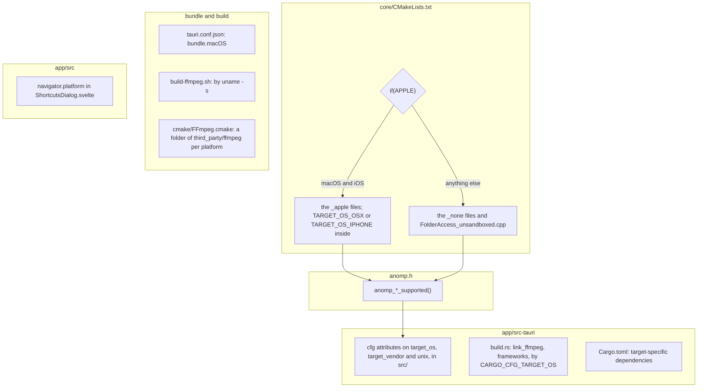

# 14. Porting

What is macOS-only in the code today, where each piece of it sits behind
an interface, and what each other platform will need. It is for a
developer starting [Phase 8 (iOS and iPadOS)](../../PLAN.md#phase-8--ios-and-ipados),
[Phase 9 (Linux)](../../PLAN.md#phase-9--linux) or
[Phase 10 (Windows)](../../PLAN.md#phase-10--windows). Those phases are
the plan: their steps, their exits, and the minimum OS versions
([`PLAN.md` §4](../../PLAN.md#4-decisions), #5: iOS 17, Ubuntu 24.04 or
Fedora 40 with WebKitGTK 4.1, Windows 11). This chapter describes the
code as it is, so a port starts from what exists rather than from the
plan's memory of it.

## What is portable already

Most of the app has no platform code at all:

- **Decoding and encoding.** FFmpeg decodes every format on every
  platform ([`PLAN.md` §4](../../PLAN.md#4-decisions), #3), from one pinned,
  LGPL, audio-only build, through one JUCE `AudioFormat`
  (`FFmpegAudioFormat`), and writes recordings (`FFmpegEncoder`). Only
  the build script and the CMake import are per platform (see
  [Building, bundling, signing and CI](#building-bundling-signing-and-ci)).
- **Audio output.** JUCE's `AudioDeviceManager` opens CoreAudio on
  macOS, and ALSA, WASAPI or iOS's audio unit elsewhere; the engine
  (`AudioEngine`, `PlayerEngine`) never names a device type. The
  effects library (`effects/`) is plain C++20 with no dependencies.
- **Tags.** TagLib, built from source with the same `WITH_*` formats
  everywhere (`cmake/TagLib.cmake`); `TagReader` already opens a file by
  its wide-character path on Windows (`#if JUCE_WINDOWS`).
- **The C API.** `anomp.h` is plain C with UTF-8 strings. Every
  platform service in it has a `*_supported()` function, so Rust asks
  rather than assumes, and the fallbacks return "not supported" rather
  than failing to link.
- **Paths.** The library stores a track's path relative to its folder,
  `/`-separated, and joins it with `library::track_path` (component by
  component, so the OS's separator is used); the H4 rule for folder
  pictures compares those stored, `/`-separated paths as text, so it
  means the same on every OS. Cue sheets, M3U8 import and the import of
  the user's data accept `\` as well as `/` in the paths they read. A
  folder's own path is stored through `library::paths::canonical`
  (without Windows' verbatim `\\?\` prefix), and a file is matched to
  its folder by `paths::within` (ignoring case on Windows), so a path
  from Explorer or a playlist finds its folder. The log scrubs Windows'
  drive and share paths as it does Unix ones (`logging::path_at`). The C
  API takes absolute UTF-8 paths and checks them with JUCE, which knows
  each OS's form.
- **Rust's services.** SQLite is bundled (`rusqlite`'s `bundled`
  feature), HTTP is `ureq` with rustls and the OS's trust store, folder
  watching is the `notify` crate (FSEvents on macOS; inotify and
  `ReadDirectoryChangesW` where it runs elsewhere), and thumbnails are the
  `image` crate: none of them is macOS-only.
- **The frontend** uses standard web APIs only (no WebKit-only CSS or
  JavaScript is known to be in use); `PLAN.md` §6's risk table names
  WebKitGTK's and WebView2's differences as a risk to check on each OS.

## How a platform is chosen

The choice is made in a different place in each layer:

## The core's seams

Each platform service in the core is one header (the interface), an
`_apple` implementation and a fallback. `core/CMakeLists.txt` compiles
the `_apple` files when CMake's `APPLE` is set (macOS and iOS; the
Objective-C++ ones with `-fobjc-arc`, linking MediaPlayer and AppKit, or
UIKit when `CMAKE_SYSTEM_NAME` is `iOS`), and the fallbacks otherwise.
There is no per-OS branch beyond that yet: Linux and Windows both get the
fallbacks today, and an `_apple` file tells macOS from iOS inside itself
with `TARGET_OS_OSX` or `TARGET_OS_IPHONE`.

| Area | Interface | macOS today | Fallback today | iOS and iPadOS ([Phase 8](../../PLAN.md#phase-8--ios-and-ipados)) | Linux ([Phase 9](../../PLAN.md#phase-9--linux)) | Windows ([Phase 10](../../PLAN.md#phase-10--windows)) |
|---|---|---|---|---|---|---|
| Folder access | `FolderAccess.h` | `FolderAccess_apple.mm`: security-scoped `NSURL` bookmarks, read-only (or writable, for recordings), resolved without UI or mounting; `realpath` gives the names as stored | `FolderAccess_unsandboxed.cpp`: the bookmark is the absolute path in UTF-8, access is always open and never stale | the same `FolderAccess_apple.mm` (its iOS branch: no options, the scope is implicit); folders come from the document picker, and the sandbox makes the bookmark essential | the unsandboxed file serves; a Flatpak build (§8.5's option) would need the document portal instead | the unsandboxed file serves; long paths (`\\?\`) and case-insensitive comparison are Phase 10's |
| Cloud placeholders (H12) | `FileStatus.h` | `FileStatus_apple.cpp`: `stat()`'s `SF_DATALESS` flag, which never downloads | `FileStatus_none.cpp`: a file that exists is here (`no`), else `unknown` | the same `FileStatus_apple.cpp` (iCloud Drive through the Files app) | the fallback; no common placeholder scheme is known | OneDrive's Files On-Demand keeps placeholders too: a Windows file for `FileStatus` reading the file's attributes (for example `FILE_ATTRIBUTE_RECALL_ON_DATA_ACCESS`) without opening it |
| Now Playing and media keys | `MediaControls.h` | `MediaControls_apple.mm`: `MPNowPlayingInfoCenter` and `MPRemoteCommandCenter` | `MediaControls_none.cpp`: the base `Backend`, which does nothing; `isSupported()` is false | the same `MediaControls_apple.mm` (its `UIImage` branch): the lock screen and Control Center, which also need the audio session below | MPRIS over D-Bus (Phase 9 names `mpris-server` or `souvlaki` in Rust, or `sdbus` in the core) | the System Media Transport Controls (SMTC), through `souvlaki` or the `windows` crate |
| Dock menu (F6) | `DockMenu.h` | `DockMenu_apple.mm`: adds `applicationDockMenu:` to tao's app delegate at run time | `DockMenu_none.cpp`: the base `Backend`, shows nothing | nothing: `DockMenu_apple.mm` returns the base `Backend` without `TARGET_OS_OSX` | nothing; the tray menu (F7) covers it | a taskbar jump list may follow (`DockMenu_none.cpp`'s comment) |
| Headphones (O11) | `OutputRoute.h` | `OutputRoute_apple.mm`: the built-in output's data source (`'hdpn'`); a Bluetooth device is `unknown` | `OutputRoute_none.cpp`: always `unknown` | already written: the `AVAudioSession` route's ports (`TARGET_OS_IPHONE` branch), untested on a device | to design (the ALSA or PipeWire port's jack state) | to design (the endpoint's form factor, through the MMDevice API) |
| Volumes (H22) | `VolumeWatcher.h` | `VolumeWatcher_apple.mm`: `NSWorkspace`'s mount and unmount notifications | `VolumeWatcher_none.cpp`: created and destroyed, reports nothing | nothing: iOS mounts no volumes, and `VolumeWatcher_apple.mm` reports nothing there | to design (udisks2 over D-Bus, or watching the mount table) | to design (the OS's volume arrival and removal notifications) |
| Audio session | none yet | not needed | — | **a new seam**: `AVAudioSession`'s `.playback` category, the background audio mode, interruptions and route changes (Phase 8) | not needed | not needed |

Each seam in more detail:

- **`FolderAccess`** (`core/src/FolderAccess.h`) is a class with two
  static functions, `createBookmark(folder, bookmark, writable)` and
  `start(bookmark, error)`, and an object that keeps access open until it
  is destroyed (`getFolder()`, `isStale()`). Its private `scope` pointer
  is the platform's handle to release (the `NSURL` on Apple, always null
  in the unsandboxed file). There is **no `_none` file for `FolderAccess`**: the
  fallback is `FolderAccess_unsandboxed.cpp`, because "no sandbox" is a
  real implementation (the path is a durable reference there), not a
  missing one. C API: `anomp_bookmark_create`,
  `anomp_bookmark_create_writable`, `anomp_folder_access_*`.
- **`FileStatus`** (`core/src/FileStatus.h`) is one static function,
  `isDataless(file)`, returning `no`, `yes` or `unknown`; any thread. C
  API: `anomp_file_is_dataless`.
- **`MediaControls`** (`core/src/MediaControls.h`) keeps the
  platform-neutral part (the published `State`, clamping, which commands
  are allowed) in `MediaControls.cpp`, and the OS part in a `Backend`
  with `attach`, `detach`, `update(state, changes)` and
  `canShowArtwork`. `createPlatformBackend()` and `isSupported()` are
  the two functions each platform file defines. Main thread only. C API:
  `anomp_media_controls_*`.
- **`DockMenu`** (`core/src/DockMenu.h`) has the same shape: the items
  and the gate on choices in `DockMenu.cpp`, and a `Backend` with
  `attach`, `detach` and `update`; each platform file defines
  `createPlatformBackend()` and `isSupported()`. Main thread only. C
  API: `anomp_dock_menu_*`.
- **`OutputRoute`** (`core/src/OutputRoute.h`) is one static function,
  `headphones(deviceName)`, asked by `AudioEngine::outputIsHeadphones`.
  C API: `anomp_engine_output_is_headphones`.
- **`VolumeWatcher`** (`core/src/VolumeWatcher.h`) is a class whose
  platform part is a private `Platform` struct each file defines,
  with its constructor, destructor and `isSupported()`; `notify` reports
  a volume as the platform would (and lets tests do so). Main thread
  only. C API: `anomp_volume_watcher_*`.

The core's tests follow the same split: `MediaControlsTests.cpp` drives
the platform-neutral class through a recording `Backend`, the C API's
`*_supported()` tests expect `1` exactly on Apple (`JUCE_MAC`,
`JUCE_IOS`), `FolderAccessTests.cpp`'s "Folder bookmarks follow a moved
folder" runs on Apple only, and `VolumeWatcherTests.mm` is compiled on
macOS only (`core/tests/CMakeLists.txt`). `CApiTests.cpp`'s asynchronous
load tests pump the run loop the engine's events arrive on: the
CFRunLoop on Apple platforms, and JUCE's own queue
(`juce::detail::dispatchNextMessageOnSystemQueue`) on Linux and Windows,
a branch that has not yet been compiled there.

**The message loop.** The engine's events are dispatched by a
`juce::Timer` on the main thread, which works because JUCE's messages
ride on the run loop Tauri runs ([chapter 1](01-overview.md#who-owns-which-thread)).
That is proven on macOS only; `PLAN.md` §6 lists re-checking it on iOS,
Linux (where JUCE has its own event loop, which something must pump)
and Windows as a risk.

## The Rust backend's platform code

Every `#[cfg(…)]` on a platform in `app/src-tauri/src`, and the code that
is platform-specific without one:

| Where | What | Elsewhere today | What a port needs |
|---|---|---|---|
| `metadata/keys.rs` (`store`), `Cargo.toml`'s `[target.'cfg(target_os = "macos")'.dependencies]` | keys and tokens (Discogs, ListenBrainz) in the login keychain, through `keyring-core` and `apple-native-keyring-store` | a `store` that reads nothing and refuses to save ("Keys can't be saved on this platform yet") | iOS: the same crate's `protected` store and the keychain entitlement; Linux: the Secret Service, with a clear message when no keyring daemon runs; Windows: the Credential Manager (Phases 8–10) |
| `lib.rs`, `on_window_event` | `target_os = "macos"`: closing the main window hides it and the music plays on | the window closes | a decision per OS (a tray app on Windows and Linux usually keeps playing only with the tray on) |
| `lib.rs`, `RunEvent::Opened` | `macos` or `ios`: files opened from the Finder play (F5) | not compiled | Linux and Windows pass opened files on the command line, to a second process: a single-instance hand-off |
| `lib.rs`, `RunEvent::Reopen` | `macos`: clicking the Dock icon shows the hidden main window | not compiled | nothing, if the window isn't hidden on close |
| `lib.rs`, `run` | `#[cfg_attr(mobile, tauri::mobile_entry_point)]` | — | already there for iOS |
| `main.rs` | `windows_subsystem = "windows"` in release builds, so no console opens | — | already there for Windows |
| `shell/notifications.rs`, `show` | `macos`: `notify_rust::set_application` with the bundle identifier, once | `notify-rust`'s own defaults; not compiled on iOS (`Cargo.toml` makes `notify-rust` a desktop-only dependency) | Windows' toasts name an installed app (an AppUserModelID, set by the installer); iOS needs its own notifications (Phase 8) |
| `diagnostics.rs`, `os_version` | `target_vendor = "apple"`: `kern.osproductversion` through `sysctlbyname` | `None`, so "Copy diagnostics" names the OS without its version | a version per OS (for example `/etc/os-release`, `RtlGetVersion`) |
| `library/watch.rs`, `lower_priority` | `apple`: the utility QoS class; other Unix: `setpriority` to niceness 10 | nothing on Windows | Windows: a lower thread priority for background scans |
| `quitting.rs`, `skip_static_destructors` | `libc::atexit` and `libc::_exit`, with no `cfg` | — | both exist in Windows' C runtime too (the `libc` crate declares them), so the rule holds as is; check that JUCE's statics behave the same at exit |
| `diagnostics.rs`, `self_test.rs` | `APP_SANDBOX_CONTAINER_ID` tells a sandboxed run (diagnostics' "sandboxed", `--require-sandbox`) | not set, so never sandboxed | iOS: always sandboxed, by other means |
| `library/access.rs`, `in_trash` | a folder in `.Trash` or `.Trashes` (macOS), a freedesktop `Trash/files` or a volume's `.Trash-<uid>/files` (Linux), or `$Recycle.Bin` (Windows) | — | nothing more |
| `servers/discovery.rs`, `Info.plist` | finding Jellyfin servers by UDP broadcast and Plex servers by GDM; macOS asks for the Local Network permission (`NSLocalNetworkUsageDescription`, worded for the remote and servers) | the broadcasts as they are | iOS: the same permission and the multicast entitlement (`com.apple.developer.networking.multicast`), or address entry only (Phase 8) |
| `servers/mod.rs`, `device_name` | the device's kind as servers list it ("Mac", "iPhone or iPad", "Windows PC", "Linux PC") by `cfg!(target_os)` | — | nothing more |
| `library/paths.rs` | `canonical` and `within` behave as `std::fs::canonicalize` and `Path::strip_prefix` | on Windows (`cfg!(windows)`), `canonical` drops the verbatim `\\?\` prefix and `within` ignores case | nothing more |
| `shell/mod.rs` | `#[cfg(desktop)]` on the menu bar, Dock menu, tray, mini player and Help windows (`menu.rs`, `dock.rs`, `tray.rs`, `mini.rs`, `help.rs`) and notifications, since Tauri compiles `tauri::menu` and `tauri::tray` on desktop only | on iOS `shell`'s functions do only what applies: no shortcuts, no mini player, no notifications | items only the menus call (the Dock menu's wrapper in `anomp.rs`, transport helpers in `queue/mod.rs`, `audio.rs` and `recording.rs`) carry `#[cfg_attr(not(desktop), allow(dead_code))]`; both branches pass Clippy, but the iOS one has not been built for iOS yet |
| `shell/menu.rs`, `install` | the app menu is named after the app and holds About, Settings…, Services, Hide, Hide Others, Show All and Quit, as macOS lays it out | the same menus, which Windows and Linux draw in the window | a layout per OS (Settings and About where Windows and Linux put them); `CmdOrCtrl` accelerators already mean Ctrl there |

Tests that make symbolic links or change permissions are `#[cfg(unix)]`
(in `library/access.rs`, `library/scanner.rs`, `library/thumbs.rs`,
`library/art.rs`, `metadata/folder_art.rs`), and the two that move a
folder and expect its bookmark to follow are `#[cfg(target_vendor =
"apple")]` (`a_moved_folder_keeps_its_place_in_the_library`,
`moved_folder_keeps_its_tracks`). `anomp.rs`'s tests expect
`VolumeWatcher::supported()` exactly on macOS and media controls exactly
on macOS and iOS: they change with the first real implementation.

### The sandbox and folder access

Rust never sees a bookmark's contents: `library/access.rs` stores the
core's bytes in `folders.bookmark` and resolves them with
`open_folder`/`open_folder_of`, holding the returned `OpenFolder` until a
file is open ([chapter 6](06-rust-backend.md#the-library)). That stays
the same on every OS; only what the bytes mean changes (a bookmark on
Apple, the path in UTF-8 elsewhere). `FolderState` (`Missing`,
`NoPermission`, `InTrash`, `MostlyGone`…) is decided in Rust from what
the file system says, so it ports as is, apart from `in_trash` above;
`access::testing::FakeBookmarks` lets its tests run on any OS. Opening a
folder by its stored path when the bookmark fails (another build's, a
deleted folder's) is how an unsandboxed bookmark behaves anyway.

`anomp::file_is_dataless` (H12) is called before any background read of
a library file; with the fallback it answers "no" for every file that
exists, so the scanner, the analysis worker and embedded art simply read.

## Configuration and bundle settings

- **`app/src-tauri/tauri.conf.json`**: `bundle.macOS` holds the minimum
  macOS (`14.0`), the entitlements file, FFmpeg's four dylibs by major
  version (`frameworks`, from `third_party/ffmpeg/macos-universal/lib/`),
  ad-hoc signing (`signingIdentity: "-"`) and the hardened runtime off
  (`build-app.py` turns it on with a real identity). `bundle.targets` is
  `"all"`, so Linux and Windows builds would try every bundler there;
  `icon.ico` is already in the icon list. Each port adds its own
  section (`bundle.linux`, `bundle.windows`, `bundle.iOS`) with FFmpeg's
  libraries for that platform; `fileAssociations` applies to all.
- **`Entitlements.plist`** (the App Sandbox, user-selected files
  read-write, app-scoped bookmarks, network client and server) and
  **`Info.plist`** (`NSLocalNetworkUsageDescription`) are macOS's. iOS
  needs its own: background audio, the keychain group, the
  local-network description.
- **Capabilities** (`capabilities/default.json`, `mini.json`,
  `help.json`) name `../gen/schemas/desktop-schema.json`; on iOS a
  capability for the main window only, against the mobile schema, since
  there is no mini player or Help window. The permission sets in
  `permissions/` are platform-neutral.
- **`.cargo/config.toml`** sets `DYLD_LIBRARY_PATH` to
  `third_party/ffmpeg/macos-universal/lib` for processes Cargo runs
  (`cargo test --release`); Linux needs `LD_LIBRARY_PATH` and Windows
  `PATH`, or the libraries copied next to the test binary.
- **`rust-toolchain.toml`** lists the two macOS targets only; each port
  adds its targets (and `doctor.py` checks them, through `TARGET_OS`).

## The frontend

- `lib/platform.ts` tells the platform from `navigator.platform` (an
  iPad reporting "MacIntel" by its touch points). `lib/keys.ts`'s
  `keys()` writes `CmdOrCtrl` as ⌘ (and Alt as ⌥, Shift as ⇧) on macOS
  and iOS, and as `Ctrl+…` elsewhere, for the shortcuts sheet and for
  messages that name a shortcut (`{keys}`: `general.onTopHint`,
  `help.backHint`, `sidebar.settingsShortcut`). The menus' accelerators are `CmdOrCtrl`, which Tauri
  maps the same way. The user guide's shortcuts appendix is written as
  macOS shows them (`check-user-guide.py` compares it in that form).
- The page's own keys accept `metaKey || ctrlKey` (`+page.svelte`,
  `VirtualList.svelte`, `BrowsePane.svelte`, `QueuePanel.svelte`,
  `SearchResults.svelte`), so ⌘ and Ctrl both work. The Help window's
  Back key is ⌘[ on macOS and iOS, and Alt+← elsewhere
  (`keys.ts`'s `HELP_BACK`, `isHelpBack`).
- `en.json`'s plain messages are macOS's text. Each one that names "this
  Mac", the Finder, iCloud or the keychain has `@windows` and `@linux`
  forms (and `@ios` where iOS differs), which `t` prefers there
  ([chapter 7](07-frontend.md#text)); `tests/i18n.test.mjs` fails on one
  without them. The user guide is written for macOS throughout, and
  needs the same care when a port ships.
- On iOS the layout itself changes (compact iPhone and split-view iPad
  layouts, touch targets): Phase 8's steps.

## What the fallbacks lose

A Linux or Windows build made today, with the fallbacks, would still
play, scan, search, fetch metadata and record. What its user would
notice:

- **No media keys, lock screen or OS media overlay**: the keyboard's
  play and next keys, a headset's buttons and the taskbar's or desktop's
  media controls do nothing, and nothing shows what is playing outside
  the app (`MediaControls`).
- **No Dock menu**, which Linux and Windows don't have anyway; the
  menu-bar controls (the tray) still work where the desktop shows a tray.
- **Crossfeed's "Only with headphones" never turns it on**, since the
  route is always `unknown` (`OutputRoute`).
- **A drive plugged back in isn't noticed** until the next relaunch or
  scan: its folders stay unavailable meanwhile (`VolumeWatcher`).
- **OneDrive placeholders are downloaded** by a scan on Windows, which
  could pull down a whole library (`FileStatus`).
- **Keys can't be saved**: Discogs and ListenBrainz can't be used
  (`metadata/keys.rs`).
- **Files opened from the file manager don't play** in the running app
  (no `RunEvent::Opened` there).
- **Closing the main window quits** rather than playing on.

## Portability problems fixed

Found while writing this chapter and fixed the same day (2026-10-10);
none changed what macOS does. `PLAN.md` records each under D4.

- **Windows paths in logs**: `logging::path_at` scrubs drive
  (`C:\…`, `C:/…`), share (`\\server\…`) and verbatim paths at info and
  above, as H9's rule asks.
- **Folder paths on Windows**: `add_folder` and `relocate_folder` store
  `paths::canonical`'s plain form instead of `std::fs::canonicalize`'s
  verbatim `\\?\C:\…`; `open_folder_of`, `external::library_track`,
  `playlists::resolve` and the overlap check match through
  `paths::within`, which ignores case on Windows.
- **M3U8 entries with a drive letter or a share** are paths on Windows
  (`playlists::entry_path`), and another computer's elsewhere, found by
  their last folders and file name.
- **The Help window's Back key** is Alt+← off macOS and iOS, and its
  hint names the platform's keys.
- **`access::in_trash`** knows a Linux volume's `.Trash-<uid>` and
  Windows' `$Recycle.Bin`.
- **`shell/` on iOS**: its desktop-only parts are `#[cfg(desktop)]`.
- **Messages that name macOS** have per-platform forms, and shortcuts in
  messages follow the platform.
- **The core's asynchronous C API tests** pump JUCE's queue off Apple
  platforms instead of being skipped.

The Linux, Windows and iOS branches of these fixes are tested where a
test can run on macOS (the path, trash, playlist and log functions take
the platform as a parameter, or are pure); the core's test pump and the
iOS build are compiled first by Phases 8–10.

## Building, bundling, signing and CI

What each step assumes today, and what each OS will need. The release
steps themselves (signing, packages, store submission) are in
[`PLAN.md` §8.4](../../PLAN.md#84-ios-and-ipados),
[§8.5](../../PLAN.md#85-linux) and [§8.6](../../PLAN.md#86-windows);
[chapter 13](13-building-and-releasing.md) explains the macOS scripts.

| Step | Today (macOS) | iOS | Linux | Windows |
|---|---|---|---|---|
| FFmpeg (`scripts/build-ffmpeg.sh`) | `uname -s` must be `Darwin`; writes `third_party/ffmpeg/macos-universal/` (arm64 and x86_64 merged with `lipo`) and, with `--fuzz`, `third_party/ffmpeg/macos-arm64-fuzz/` | device and simulator builds as dynamic frameworks in an `.xcframework` | `linux-x86_64` (and arm64 if targeted), the same flags | x64 DLLs (MSYS2 or MinGW), the same flags |
| CMake import (`cmake/FFmpeg.cmake`) | `macos-universal` (or the fuzz build); anything else stops with "No FFmpeg build for this platform yet"; install names `@rpath/lib*.N.dylib` | a branch for the `.xcframework` | `.so` with an `$ORIGIN` rpath | import libraries and DLLs |
| Top-level `CMakeLists.txt` | `CMAKE_OSX_DEPLOYMENT_TARGET` 14.0 | iOS 17 | — | the dynamic CRT (`CMAKE_MSVC_RUNTIME_LIBRARY`), to match Rust's |
| `app/src-tauri/build.rs` | `link_ffmpeg` panics for any OS but macOS; links `c++`, clang's runtime (`xcrun`) and eight frameworks; debug builds get an rpath into `third_party/` | `CMAKE_SYSTEM_NAME=iOS` from `CARGO_CFG_TARGET_OS`, UIKit instead of AppKit | `asound`, `pthread`, `dl` (Phase 9) | `winmm`, `ole32`, `uuid`, `ws2_32`, `version`, `shlwapi`… (Phase 10) |
| `scripts/build-app.py` | refuses to run off macOS; universal `.app` and DMG | Tauri's iOS build | `.deb` and AppImage | NSIS (or MSI) installer |
| `scripts/check-bundle.py` | a `.app`: `lipo` slices, `@rpath` install names, `codesign`, entitlements, the minimum macOS | a check of the `.ipa` | the packages' `$ORIGIN` lookup, so the system FFmpeg is never used | DLLs next to the executable, Authenticode signatures |
| `scripts/notarize.py` | `notarytool`, staple, `spctl` | App Store review instead | — | — |
| `scripts/release.py` | finds `bundle/macos/*.app` and `bundle/dmg/*.dmg`, zips with `ditto`, names files `ano-mp_<version>_macos-<arch>` | TestFlight, not a GitHub asset | each package, with its checksums | the installer, with its checksum |
| `scripts/self-test-bundle.py` | macOS only (prints and passes elsewhere); runs the sandboxed bundle | a simulator run | an unsandboxed self-test is still useful | the same |
| `scripts/check-signing.py` | the keychain's identities; macOS only | the same keychain | GPG keys, if packages are signed | the Authenticode certificate |
| `scripts/doctor.py` | install hints for macOS, Linux and Windows; `FFMPEG_PLATFORMS` knows `darwin` only (elsewhere "no build … yet"); the Xcode and `llvm@22` checks run on macOS only | — | its FFmpeg folder | its FFmpeg folder |
| Fuzzing (`CMakePresets.json`'s `fuzz`, `run-fuzzers.py`) | Homebrew's `llvm@22` at `/opt/homebrew`, `ANOMP_FUZZ_DEVELOPER_DIR` for the runner's newer Xcode | — | a Linux job could run the fuzzers with the distribution's clang | — |

**CI.** Three of the four workflows run on `macos-15`: `ci.yml`
(`check-all.py`, and nothing else), `release.yml` and `fuzz.yml`, the
last two setting `ANOMP_FUZZ_DEVELOPER_DIR` for the fuzz build.
`audit.yml` already runs on `ubuntu-24.04`, since it only checks pins and
advisories. Phase 9 adds an `ubuntu-latest` job and Phase 10 a
`windows-latest` one, each running `check-all.py`; checks go in that
script, never in the workflow (`CLAUDE.md`). Phase 8 adds an iOS
simulator build.

## Recipe: add a platform's implementation of a seam

For one of the six seams above (or a new one, such as iOS's audio
session). Take `MediaControls` on Linux as the example.

1. **The file.** `core/src/MediaControls_<os>.cpp` (`_linux`, `_windows`,
   or `.mm` for Objective-C++), next to the `_apple` and `_none` ones,
   in JUCE style. It defines what the header leaves to the platform:
   for `MediaControls` and `DockMenu`, `createPlatformBackend()` (a
   `Backend` subclass in an anonymous namespace) and `isSupported()`;
   for `FileStatus` and `OutputRoute`, the one static function; for
   `VolumeWatcher`, its `Platform` struct, constructor, destructor and
   `isSupported()`; for `FolderAccess`, `createBookmark`, `start` and the
   destructor. Keep the header's thread rule (main thread only for
   `MediaControls`, `DockMenu` and `VolumeWatcher`: a callback from
   another thread is posted to the message thread before it reaches the
   handler), and report failures as the header says rather than
   throwing. Update the header's comment that lists the implementations.
2. **The CMake selection.** In `core/CMakeLists.txt`, the `else()`
   branch of `if(APPLE)` becomes one branch per OS (for example
   `elseif(CMAKE_SYSTEM_NAME STREQUAL "Linux")`), listing the new file
   instead of the `_none` one; the other seams keep their fallbacks. Add
   the libraries it needs (`target_link_libraries(anomp_core PRIVATE …)`)
   and the same libraries to `build.rs`'s link line for that
   `target_os`, which links the core by hand. `check-sources.py`
   compares the lists with the disk, and there is no globbing.
3. **The C API** usually needs nothing: `anomp_*_supported()` now
   returns `1` on that OS. Change its comment in `anomp.h` if it names
   the platforms.
4. **Tests.**
   - The platform-neutral logic is already tested; add a Catch2 test
     of what the new file does that can run on CI (a test file of its
     own, or a case under `#if JUCE_LINUX`, listed in
     `core/tests/CMakeLists.txt`, as `VolumeWatcherTests.mm` is on
     macOS), and run it under ASan and TSan.
   - Update the tests that pin support to Apple: the `*_supported()`
     cases in `CApiTests.cpp` and `MediaControlsTests.cpp`, and
     `anomp.rs`'s `supported()` assertions.
   - Anything only a desktop session shows (a D-Bus session bus, a
     media overlay) goes on the release smoke test for that OS, as
     `docs/release-smoke-test.md` does on macOS.
5. **Rust**, if the seam reaches it: remove a `cfg` that kept the
   feature to macOS, and give a `cfg`'d store (as `metadata/keys.rs`'s)
   its implementation for that `target_os`, with its target-specific
   dependency in `Cargo.toml` (and its licence in `deny.toml`'s list,
   or an owner decision; regenerate `THIRD_PARTY_NOTICES`).
6. **The docs, in the same commit.**
   - The repository map's line for the unit
     ([chapter 3](03-repository-map.md)) when its responsibility
     changes; platform files fold into their unit, so a new file needs
     no line of its own.
   - Its class dictionary entries (`docs/class-dictionary/core.md`):
     a new `Backend` subclass or helper type gets an entry, as
     `AppleBackend` and `VolumeWatcher::Platform` have, and the unit's
     entry names the new file; then `scripts/class-dictionary.py`
     rewrites the index (`--check` fails on a type without an entry).
   - [Chapter 4](04-core.md#platform-code)'s table of platform code,
     and this chapter's tables (the implementation moves from "to
     design" to the file).
   - What the user sees: the user guide's chapter for the feature, if
     it now works on that OS.

## Where to go next

- The plan for each port: [Phase 8](../../PLAN.md#phase-8--ios-and-ipados),
  [Phase 9](../../PLAN.md#phase-9--linux),
  [Phase 10](../../PLAN.md#phase-10--windows), and the risks in
  [`PLAN.md` §6](../../PLAN.md#6-key-risks).
- Why the sandbox, bookmarks and placeholders work as they do: the
  [hardening record](../design/phase-7-hardening.md) (H4, H11, H12,
  H22).
- The core's platform code as a part of the core:
  [chapter 4](04-core.md#platform-code).
